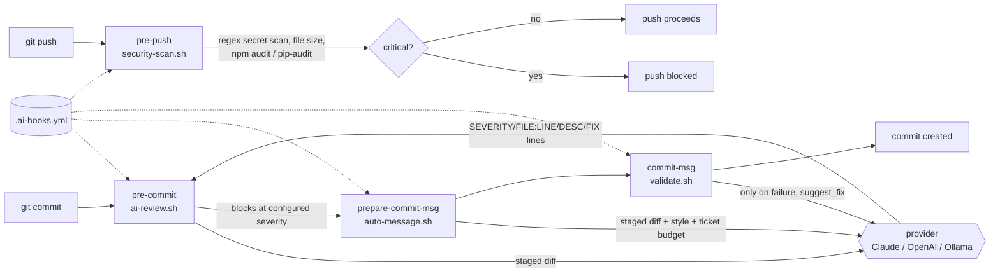

# AI Git Hooks

[](https://github.com/Sagargupta16/ai-git-hooks/actions/workflows/test.yml)


> AI-powered git hooks that review your code, generate commit messages, catch bugs, and scan for security issues - before you push.

Drop-in git hooks that use AI (Claude, OpenAI, Ollama) to automate code quality checks at every stage of your git workflow.

## Hooks

| Hook | Description | Trigger |
|------|-------------|---------|
| [AI Code Review](hooks/pre-commit/) | Reviews staged changes for bugs, style issues, and anti-patterns | `pre-commit` |
| [Commit Message Generator](hooks/prepare-commit-msg/) | Auto-generates conventional commit messages from your diff | `prepare-commit-msg` |
| [Commit Message Validator](hooks/commit-msg/) | Validates commit messages follow conventions | `commit-msg` |
| [Pre-Push Security Scan](hooks/pre-push/) | Scans for secrets, vulnerabilities, and large files | `pre-push` |

## How It Works

Each hook is a standalone Bash script. There is no daemon, no package and no
runtime beyond `git`, `curl` and `jq`: the installer copies the four scripts into
the hooks directory git reports for your project, and git runs them.



Design decisions worth knowing:

- **The secret scan is deterministic.** `pre-push` makes no AI call. A model can
  miss a key or hallucinate one, so blocking a push is left to regex patterns
  that behave the same on every run.
- **The model gets a line protocol, not free text.** The review prompt asks for
  `SEVERITY|FILE:LINE|DESCRIPTION|SUGGESTION` lines or `NO_ISSUES`, which the
  hook parses into counts and compares against `severity` to decide whether the
  commit is blocked.
- **The generator and the validator agree.** `prepare-commit-msg` spends the
  ticket prefix (`PROJ-42: `) out of the same `max_length` budget that
  `commit-msg` enforces, and the validator accepts that prefix, so the two
  default-enabled hooks never reject each other's output.
- **Every provider call is optional in CI.** `AI_HOOKS_DRY_RUN=1` replaces each
  call with a fixed response, so the 47-case suite in `scripts/test.sh` runs on
  ubuntu and macOS with no API key.

## Requirements

| Requirement | Notes |
|-------------|-------|
| `git` 2.31+ | The hooks read the staged diff and the branch name. The installer uses `rev-parse --path-format=absolute` |
| `bash` | Every hook and script uses `#!/usr/bin/env bash`. CI runs the suite on ubuntu-latest and macos-latest |
| `curl` | Used for every provider API call |
| `jq` | Required. Hooks refuse to call a provider without it: `brew install jq` / `apt install jq` |

There is no npm package - install by cloning, as below.

## Quick Start

### 1. Clone this repo

Clone it somewhere permanent. This directory is the source of the hooks, not the
project they run in.

```bash
git clone https://github.com/Sagargupta16/ai-git-hooks.git ~/tools/ai-git-hooks
```

### 2. Install into your project

```bash
cd /path/to/your-project
~/tools/ai-git-hooks/scripts/install.sh ~/tools/ai-git-hooks
```

The installer copies the four hooks into the hooks directory git reports for
your project (`git rev-parse --git-path hooks`, normally `.git/hooks/`) and
creates `.ai-hooks.yml` at the project root. Linked worktrees, submodules and a
`core.hooksPath` setting all resolve to the directory git actually runs. Run it
once per project you want the hooks in.

If the project uses husky, do not run the installer: it would replace husky's
own hook files (backed up as `<hook>.backup`), and the next `husky` run
regenerates them and drops the AI hooks. Call the hook scripts from your husky
hooks instead.

### 3. Configure

The installer seeds `.ai-hooks.yml` in your project root. The keys that matter:

```yaml
provider: claude            # claude | openai | ollama
model: claude-sonnet-5      # model to use

hooks:
  pre-commit:
    enabled: true
    severity: error         # error | warn | info
    max_files: 20
    ignore:
      - "*.lock"
      - "*.min.js"
      - "dist/**"

  prepare-commit-msg:
    enabled: true
    style: conventional     # conventional | simple | detailed
    ticket_prefix: true     # auto-detect ticket from branch name

  commit-msg:
    enabled: true
    convention: conventional
    max_length: 72

  pre-push:
    enabled: true
    scan_secrets: true
    scan_dependencies: true
    max_file_size: 5MB
```

### 4. Set your API key

```bash
# Claude (recommended)
export ANTHROPIC_API_KEY="sk-ant-..."

# OpenAI
export OPENAI_API_KEY="sk-..."

# Ollama (free, local - no key needed)
export OLLAMA_HOST="http://localhost:11434"
```

## Hook Details

### Pre-Commit: AI Code Review

Reviews staged changes and catches issues before they're committed.

**What it checks:**
- Bug patterns and logic errors
- Security vulnerabilities (XSS, SQL injection, etc.)
- Performance anti-patterns
- Missing error handling

**Example output** (the review lines depend on what the model returns):
```
[INFO] Reviewing 3 file(s)...
  src/api/users.js
  src/components/Dashboard.tsx
  src/utils/parse.js

[WARN] src/api/users.js:42
  SQL query uses string concatenation instead of a parameterized query.
  Fix: Use db.query('SELECT * FROM users WHERE id = $1', [id])

[INFO] src/components/Dashboard.tsx:108
  useEffect is missing 'userId' in its dependency array.

Summary: 0 error(s), 1 warning(s), 1 info
```

With `severity: warn` that warning blocks the commit; with the default
`severity: error` it is reported and the commit proceeds.

### Prepare-Commit-Msg: Auto-Generate Messages

Analyzes your diff and generates a commit message following your conventions.

```bash
git add .
git commit
# Hook auto-generates:
# feat(auth): add JWT refresh token rotation
#
# - Add refresh token endpoint with 7-day expiry
# - Implement token rotation on each refresh
# - Add rate limiting to prevent token abuse
```

### Commit-Msg: Validate Messages

Ensures commit messages follow your team's conventions.

```
[ERROR] Commit message validation failed.

Message: "fixed stuff"

Errors:
  - Subject does not match conventional commit format: type(scope): description

[INFO] Asking AI for a suggested fix...
Suggested message:
  fix: resolve null pointer in user authentication flow

[INFO] Fix your commit message and try again.
[INFO] Use 'git commit --no-verify' to bypass this check.
```

The checks are rule-based: conventional format, allowed type, subject length,
no trailing period, lowercase description, blank second line. The provider is
only asked for the suggested rewrite.

### Pre-Push: Security Scan

Scans the net diff of the commits about to be pushed. For a new branch that is
everything not already on a remote; for the first push of a repo it is every
file. A secret added in one commit and deleted in a later one in the same push
is not in the net diff, so it is not caught.

```
[INFO] Scanning for secrets...
[CRITICAL] Possible Anthropic API Key found
  const API_KEY = "***REDACTED***";
  Action: Remove the secret and rotate it immediately.

[INFO] Checking for large files...
[WARN] Large file detected: assets/video.mp4 (45 MB)
  Maximum allowed: 5 MB
  Action: Consider Git LFS or add to .gitignore.

--------------------------------------
Scan complete: 1 critical, 1 warning(s), 0 info

[ERROR] Push blocked due to 1 critical finding(s).
[INFO] Fix the issues above or use 'git push --no-verify' to bypass.
```

Built-in patterns cover AWS, GitHub (classic and fine-grained), Anthropic,
OpenAI (legacy and `sk-proj-` / `sk-svcacct-` / `sk-admin-`), Google, Slack,
Stripe, Twilio and SendGrid keys, PEM private keys, database connection strings
with an inline password, and quoted `password` / `secret` / `api_key` /
`access_token` / `auth_token` assignments. The matched value is redacted before it is printed.

## What Runs On Every Commit

These hooks call your provider on ordinary git operations, so it is worth knowing
the request pattern before you install them.

| Hook | Provider requests | Notes |
|------|-------------------|-------|
| `pre-commit` | 1 per commit | Sends the staged diff, truncated to `max_diff_lines` (default 500). Skipped entirely when more than `max_files` (default 20) files are staged, or when every staged file matches `ignore`. |
| `prepare-commit-msg` | 1 per commit | A second request with the staged diff, truncated to 500 lines. Skipped for `git commit -m`, merges and squashes. |
| `commit-msg` | 0, or 1 on failure | Only asks for a suggestion when validation fails and `suggest_fix: true`. |
| `pre-push` | 0 | Regex secret scan, file-size check and `npm audit` / `pip-audit`. No AI involved. |

So a plain `git commit` with the shipped config makes two requests, and `git commit -m`
makes one. Requests are serial and block the operation until they return or `timeout`
(default 30 seconds) elapses. There is no caching, batching or retry.

Knobs that reduce the number of requests: set `enabled: false` on any hook you do
not want, lower `max_files` so more commits skip the review, or commit with `-m` to
skip the message generator.

`max_diff_lines` and `hooks.pre-commit.ignore` do not change the request count.
`max_diff_lines` truncates the payload, and `ignore` only decides whether the hook
runs at all: once it does run, the request carries `git diff --cached` for every
staged file, ignored ones included.

## Supported AI Providers

| Provider | Cost | Speed | Privacy | Setup |
|----------|------|-------|---------|-------|
| **Claude** (Anthropic) | API pricing | Fast | Cloud | API key |
| **OpenAI** | API pricing | Fast | Cloud | API key |
| **Ollama** (local) | Free | Varies | Full privacy | Local install |

### Using Ollama (Free & Private)

```bash
ollama pull llama3.1
```

Then edit the existing `provider` and `model` keys in `.ai-hooks.yml`:

```yaml
provider: ollama
model: llama3.1
```

Edit them in place - do not append duplicate keys to the end of the file. The
config reader takes the first match for a top-level key, so an appended
`provider:` is ignored and the original value keeps winning.

## Scripts

| Script | Description |
|--------|-------------|
| [`install.sh`](scripts/install.sh) | Install hooks to your git project |
| [`uninstall.sh`](scripts/uninstall.sh) | Remove hooks from your project |
| [`test.sh`](scripts/test.sh) | Test hooks against sample diffs |

## Troubleshooting

**Nothing happens when I commit.** The hooks live in the target project's
`.git/hooks/`, not in the ai-git-hooks clone. Check that
`ls -l /path/to/your-project/.git/hooks/pre-commit` exists and is executable. If you
ran `install.sh` from inside the ai-git-hooks clone, you installed the hooks into the
clone - `cd` to your project and run it again with the clone path as the argument.

**`./scripts/install.sh: Permission denied`.** The scripts ship with the executable
bit set, so a `git clone` gives you a runnable copy. If your copy lost the bit, run
`chmod +x scripts/*.sh hooks/*/*.sh`, or invoke it as `bash scripts/install.sh`.

**`'jq' is required but not installed`.** Install it: `brew install jq` or
`apt install jq`. Every provider call parses JSON with `jq`, so the pre-commit hook
blocks the commit without it.

**A secret scanner false positive is blocking my push.** Add the offending path to
`hooks.pre-push.ignore` in `.ai-hooks.yml` (glob syntax). That list ships empty, so
docs and test fixtures are scanned like everything else - they are common places for
a real key to leak. Keep any pattern you add as narrow as the false positive, because
listed files are not scanned at all. Binary, minified and lockfile types are skipped
by a built-in list already.

**Switching provider had no effect.** Edit the existing `provider:` and `model:` keys
in `.ai-hooks.yml`. Appending a second `provider:` line does nothing - the config
reader takes the first match. Run with `AI_HOOKS_DEBUG=1` to print the provider and
model actually in use.

**I need to commit right now.** `git commit --no-verify` and `git push --no-verify`
bypass the hooks for one operation. To turn a single hook off for good, set
`enabled: false` on it in `.ai-hooks.yml`. To remove everything, run
`/path/to/ai-git-hooks/scripts/uninstall.sh` from your project root - it restores any
hook it backed up during install.

## Contributing

Contributions welcome - new hooks, better prompts, new AI providers, or bug fixes.

1. Fork this repo
2. Create a feature branch
3. Add your changes with tests
4. Submit a PR

See [CONTRIBUTING.md](CONTRIBUTING.md) for full guidelines.

## More AI Developer Tools

| Project | Description |
|---------|-------------|
| [claude-cost-optimizer](https://github.com/Sagargupta16/claude-cost-optimizer) | Save 30-60% on Claude Code costs - proven strategies and benchmarks |
| [claude-code-recipes](https://github.com/Sagargupta16/claude-code-recipes) | 47 copy-paste recipes for Claude Code - commands, subagents, hooks, skills, MCP integration |
| [mcp-toolkit](https://github.com/Sagargupta16/mcp-toolkit) | TypeScript middleware toolkit for MCP servers - auth, caching, rate limiting (beta) |
| [agent-recipes](https://github.com/Sagargupta16/agent-recipes) | AI agent workflows for real-world dev tasks - code review, testing, security |

## License

[MIT](LICENSE)
